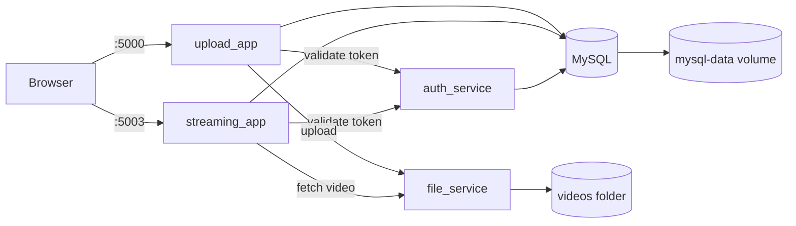

# Video Share

A containerized video upload and streaming system built for ACIT 3495 (Jaida Neilson).
Users log in, upload videos through one web app, and stream them from another.
Everything runs with Docker Compose.

## Architecture

| Container | Role | Port | Exposed to host? |
|---|---|---|---|
| `upload_app` | Login page, menu, video upload | 5000 | yes |
| `streaming_app` | Video list and playback | 5003 | yes |
| `auth_service` | Checks logins, issues and validates JWT tokens | 5001 | no (internal) |
| `file_service` | Saves and serves video files | 5002 | no (internal) |
| `mysql_service` | Users and video metadata (MySQL 8.0) | 3306 | no (internal) |

All containers share a private Docker network (`video_net`). Only the two web apps
publish ports. Data is kept in a named volume (`mysql-data`) for the database and a
bind mount (`./storage/videos`) for the uploaded video files.



## Requirements

- Docker Desktop (or Docker Engine with the Compose plugin)
- Git
- About 2 GB of free disk space for images

No local Python install is needed to run the system.

## Quick start

1. **Clone the repository**
   ```
   git clone https://github.com/jaidstarr/video_share.git
   cd video_share
   ```

2. **Create your `.env` file** from the template and set real values
   ```
   cp .env.example .env          # Windows PowerShell: copy .env.example .env
   ```
   Edit `.env`:
   ```
   MYSQL_ROOT_PASSWORD=<long random string>
   MYSQL_DATABASE=video_db
   MYSQL_USER=video_user
   MYSQL_PASSWORD=<another random string>
   MYSQL_HOST=db
   JWT_SECRET=<long random string>
   ```
   Keep `MYSQL_HOST=db` (the service name). Generate a random secret with:
   ```
   python -c "import secrets; print(secrets.token_urlsafe(32))"
   ```
   Avoid `$` and `#` in values, because Compose and `.env` parsing can mangle them.
   `.env` is git-ignored and must never be committed.

3. **Set up login users** (first run only)
   Users are seeded from `db/init.sql`, which stores passwords as hashes. To create a hash
   for a password of your choice:
   ```
   python -c "from werkzeug.security import generate_password_hash as g; print(g('your-password'))"
   ```
   Paste the output into the matching `INSERT INTO users ...` line in `db/init.sql`.
   `init.sql` only runs when the database volume is created, so if you change it later,
   run `docker compose down -v` first (this deletes database data).

4. **Build and start everything**
   ```
   docker compose up -d --build
   ```

5. **Wait for healthy status** (about 30 to 60 seconds on the first run)
   ```
   docker compose ps
   ```
   Every service should show `healthy`. Do not stop the stack during the very first
   start, because an interrupted MySQL initialization leaves a broken data folder.

6. **Use it**
   - Open http://localhost:5000 and log in.
   - Choose **Upload a video** to add one (mp4, webm, mov, mkv; up to 500 MB).
   - Choose **Watch videos** to open the streaming app on port 5003. The login cookie
     is shared, so you stay signed in.

## Everyday commands

| Task | Command |
|---|---|
| Start | `docker compose up -d` |
| Stop (keeps data) | `docker compose down` |
| Rebuild after code changes | `docker compose up -d --build` |
| Follow logs | `docker compose logs -f -t` |
| Logs for one service | `docker compose logs -t --tail=50 auth_service` |
| Status, ports, health | `docker compose ps` |
| Delete everything including data | `docker compose down -v` (also empty `storage/videos` if you want a clean slate) |

## Security notes

- Containers run as a non-root user.
- Only ports 5000 and 5003 are published. Auth, file storage, and the database are reachable
  only on the private Docker network.
- Secrets come from `.env`, never from the images or the repository.
- Passwords are stored as hashes. Logins produce a signed JWT kept in an HttpOnly cookie,
  and every request is validated by `auth_service`.
- Uploads are checked for file type and size.

## Persistence

| Data | Storage |
|---|---|
| MySQL data (`/var/lib/mysql`) | named volume `mysql-data` |
| Uploaded videos (`/app/storage/videos`) | bind mount `./storage/videos` |

Recreating a container keeps this data. `docker compose down -v` deletes the volume.

## Tests

Each service has a small pytest suite in its `tests/` folder. The apps read required
environment variables when imported, so set dummy values first. In PowerShell:

```
$env:DB_HOST="x"; $env:DB_USER="x"; $env:DB_PASSWORD="x"; $env:DB_NAME="x"
$env:JWT_SECRET="test-secret-not-real"
$env:AUTH_URL="http://a/validate"; $env:AUTH_LOGIN_URL="http://a/login"
$env:FILE_URL="http://f/upload"; $env:FILE_BASE_URL="http://f/files"
$env:UPLOAD_FOLDER="$env:TEMP\videos"
cd auth_service
pip install -r requirements.txt pytest
python -m pytest -q
```
Repeat in each service folder. The same tests run automatically in CI.

## CI/CD

`.github/workflows/ci.yml` runs on every push to `main`. For each service it:

1. runs the tests,
2. builds the image for `linux/amd64` and `linux/arm64`,
3. scans it with Trivy (HIGH and CRITICAL findings that have fixes),
4. tags it with the commit SHA (and `latest` on `main`),
5. publishes it to the GitHub Container Registry:
   `ghcr.io/jaidstarr/video_share/<service>`.

Publishing uses GitHub's built-in `GITHUB_TOKEN`, so no registry credentials are stored
in the repository.

## Troubleshooting

| Symptom | Likely cause and fix |
|---|---|
| `volumes must be a mapping` or similar compose error | indentation or a stray dash in `docker-compose.yml`; run `docker compose config` to validate |
| Login fails for every user | users were not seeded; run `docker compose down -v` and start again |
| `HMAC key must not be empty` in auth logs | `JWT_SECRET` is missing or blank in `.env` |
| Database shows `unhealthy` or restarts, with "data directory has files in it" | interrupted first start; `docker compose down -v`, then `docker compose up -d` and let it finish |
| Container restarts with `gunicorn: not found` or `[gunicorn,: not found` | missing package in `requirements.txt` or a malformed `CMD` list in the Dockerfile |
| Uploads fail with a permission error | the videos folder is not writable by the container's non-root user |
| Port already in use | another program is using 5000 or 5003; stop it or change the published port |

## Project layout

```
auth_service/      login and token validation
file_service/      video file storage
upload_app/        login page, menu, upload
streaming_app/     video list and playback
db/init.sql        schema and seeded users
docker-compose.yml all services, network, volumes, health checks, resource limits
.env.example       template for required environment variables
.github/workflows/ci.yml  CI/CD pipeline
```
